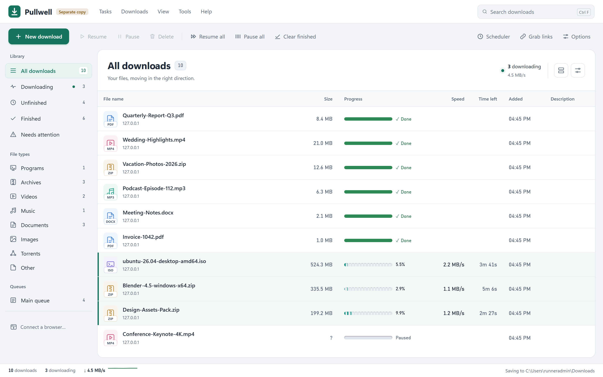
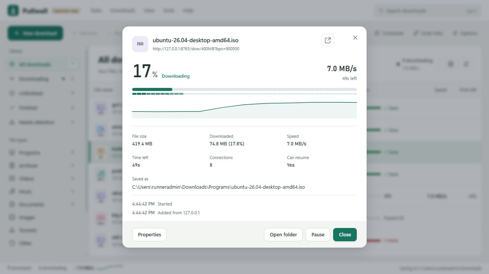
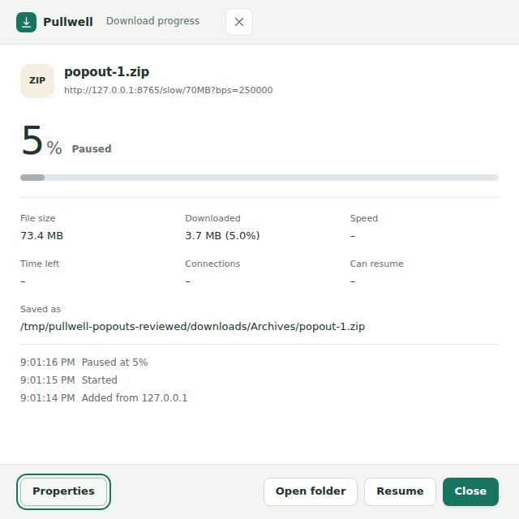
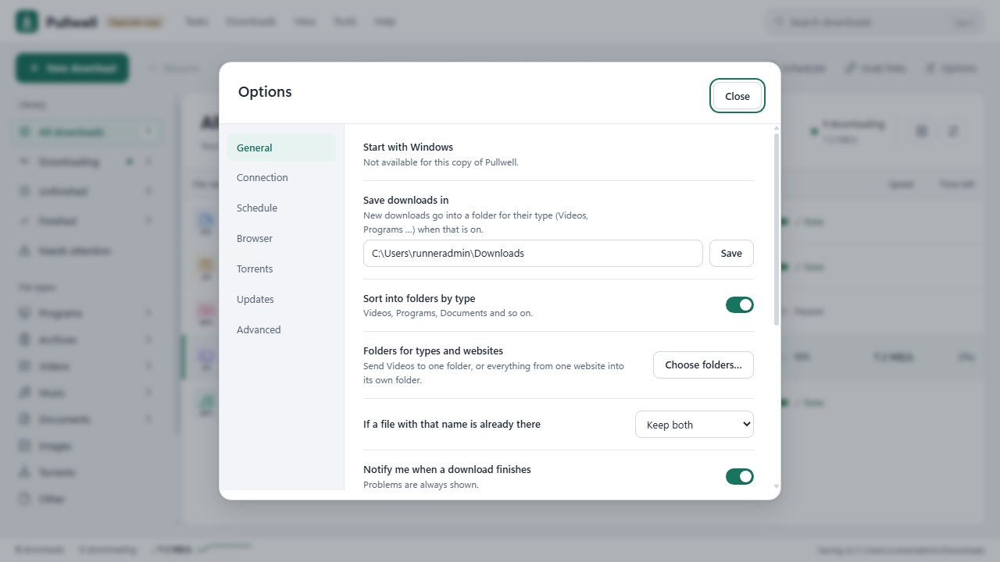
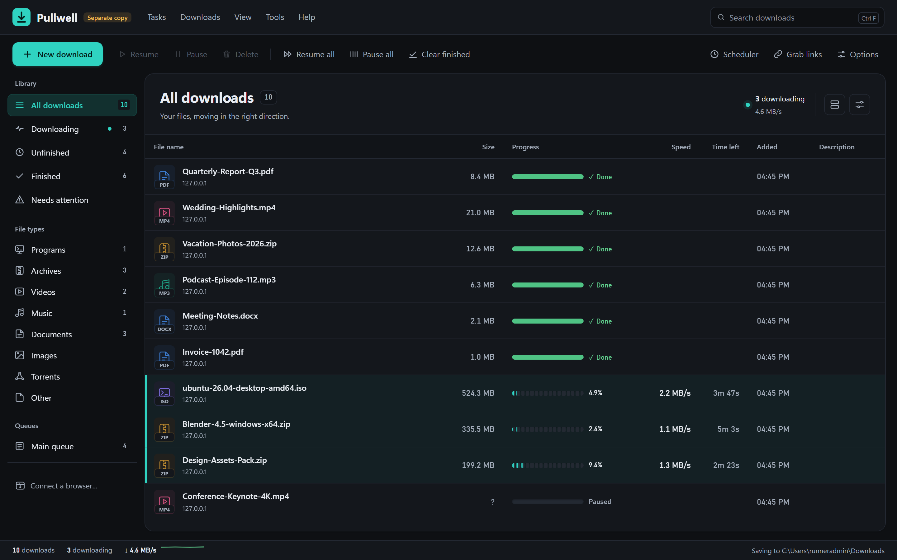

# Pullwell

A fast, reliable download manager for Windows 10 and 11, with a browser extension and no telemetry.



> **Status: first public versions, in daily use.** The name Pullwell is final.

## Install

1. Download `Pullwell.exe` from the [latest release](https://github.com/nisar87/pullwell/releases/latest).
2. Put it in a folder of its own, for example `C:\Users\<you>\Pullwell\`, and start it. There is no installer and
   no administrator prompt. Its settings and download list are kept in a `data` folder next to it.
3. Windows may warn that the program is not known yet (it is not signed). Choose **More info → Run anyway**.

Pullwell then adds itself to your Start menu. It **updates itself**: new versions are fetched from this page,
checked against their SHA-256 fingerprint and installed when nothing is downloading. Unfinished downloads continue
afterwards. **Options → Updates** can check now, ask first instead, or go back to the previous version.
**Options → Advanced → Uninstall** removes it again. Your downloaded files are never deleted.

Pullwell needs Microsoft Edge WebView2, which is part of Windows 10 and 11. If WebView2 is missing, the window
opens in Edge or Chrome instead.

## Connect your browser

Pullwell carries its own browser extension, so the extension always matches the program.

1. In Pullwell, open **Tools → Connect a browser** (or Options → Browser). Download the extension for Chrome/Edge
   or Firefox there, and note the pairing code.
2. **Chrome, Edge or Brave:** unzip the file. Open `chrome://extensions` (Edge: `edge://extensions`), switch on
   **Developer mode** and choose **Load unpacked**, then pick the unzipped folder.
   **Firefox:** open `about:debugging` → This Firefox → **Load Temporary Add-on**, and pick the zip.
3. Click the extension's icon and type the pairing code.

From then on, big downloads go to Pullwell (5 MB and up; you can change the size), and links get a
**Download with Pullwell** entry in the right-click menu. When Pullwell is not running, the browser simply
downloads the file itself.

## What it does

- Downloads with several connections at once, and resumes after a crash, a restart or a lost connection.
- Never reports a file as finished unless its size, and its checksum when one is known, is right.
- Queues with their own hours, a scheduler, speed limits (overall or per download), categories, numbered series
  (`file[001-050].jpg`), mirrors, FTP, HLS/DASH web video and BitTorrent.
- A compact window with a menu bar (Tasks, Downloads, View, Tools, Help), a toolbar, categories and queues, and a
  sortable list. It works with the keyboard too: Alt or F10 opens the menus. **Help → Keyboard shortcuts** lists
  the shortcuts.
- Light and dark themes, comfortable or compact rows, responsive layouts, and reduced-motion support.
- A progress view for each download, with speed, time left, connections and the parts of the file. Click its
  pop-out arrow or choose **Open in separate window** to keep it in an independent window. Closing the window
  leaves the download running.
- Windows notifications with **Open** and **Open folder** when a download finishes.
- Rename a download (F2), a speed limit at a click on the status bar, and a proxy (the same as Windows, none, or
  one you type, http or socks5).
- The PC stays awake while something downloads (you can switch that off).
- Optional: when you copy a link to a file anywhere in Windows, a notification offers to download it.
- `Pullwell.exe <link>` adds a link from a script or another program.

| | |
| --- | --- |
|  |  |
|  |  |

The previews use sample downloads and local test files from `scripts/dmtest/fixtures.py`.

## Privacy

Pullwell contacts only the sites you download from, and GitHub to check for updates. It sends no telemetry and
needs no account. Its window and its local interface answer only on `127.0.0.1`:

- Other programs and web pages cannot change anything through that interface.
- A browser can only send downloads after you pair it with a code.
- Copied links are only looked at when you switch that on, and only links to files are offered.

## Building

Go 1.24, standard library only, no other modules.

```
go vet ./...
go test ./...
go run ./scripts/mkres     # icon and version details for Windows (writes rsrc_windows_amd64.syso)
GOOS=windows GOARCH=amd64 CGO_ENABLED=0 go build -ldflags "-s -w -H=windowsgui" -o Pullwell.exe .
```

The full test suite takes about 7 minutes, most of it the download engine in `dm/`. On Linux the program runs
without a window for development: `go run . -root /tmp/pw`, then open `http://127.0.0.1:9197/`.

Window checks in a real browser (`scripts/uitest/`) need `python3 scripts/dmtest/fixtures.py` running, and Chrome
started with `--remote-debugging-port=9333`. Then run `node menu_check.mjs 9333 http://127.0.0.1:9197/
http://127.0.0.1:8765 <out>` (the same for `ui_check`, `prog_check`). `ext_check.mjs` loads the extension into
Playwright's Chromium.

Every push builds a test version (the `test-build` pre-release). Changing `VERSION` (and `appVersion` in
`appname.go`) publishes a release, which installed copies pick up by themselves.

## Documents

- [Road to 1.0](docs/roadmap.md): what is done and what was checked on a real Windows PC
- [Changelog](CHANGELOG.md)
- [Publishing: the steps only the owner can take](docs/publishing.md) (browser stores, winget, code signing)
- [Window, tray and notifications design](docs/window-tray-notifications-design.md)

## More from the developer

Pullwell is one of several small free tools made by Nisar Ahmad. The others are listed at [nisarworks.com](https://nisarworks.com/), and the link is also in **Help → About**.

## Licence

MIT. Pullwell is free and open source; voluntary donations are welcome.
